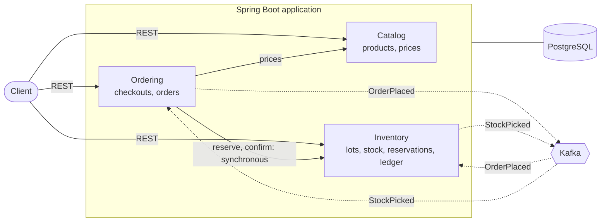
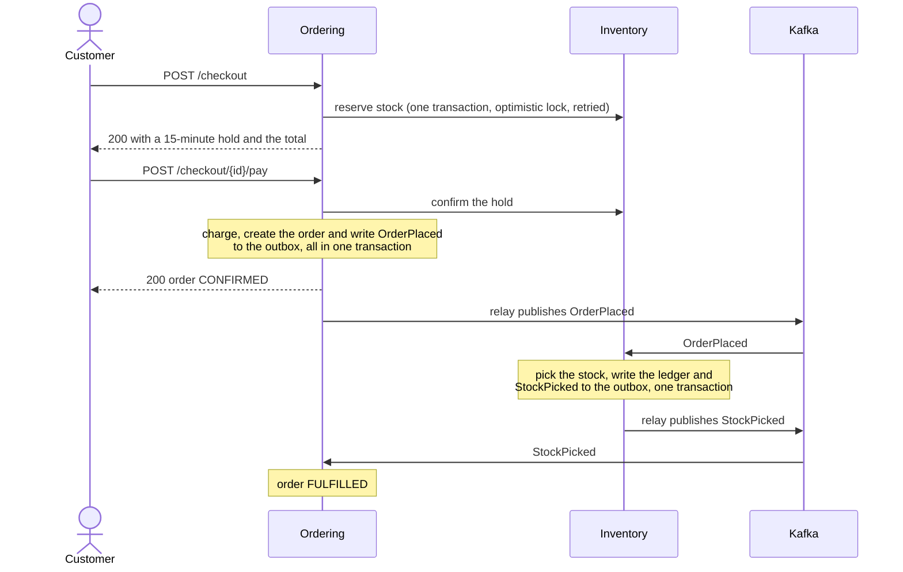

# Beans

[](https://github.com/pabloquirogaotero/beans/actions/workflows/ci.yml)

Inventory, ordering and fulfilment backend for a specialty-coffee retailer: Java 21, Spring Boot, PostgreSQL and Kafka.

I built it to practise how backend systems are structured, on a domain that forces the hard parts: two customers racing for the last bag, money and stock that must never disagree, events that may arrive twice, and food lots that must be traceable when one goes bad.

**Status:** the backend is complete end to end (browse, check out, pay, fulfil, trace a lot). There is no storefront UI; you drive it through the REST API or Swagger UI.

---

## Try it

Needs Docker. One command builds the app and starts it with PostgreSQL and Kafka:

```bash
docker compose up --build
```

Swagger UI is at <http://localhost:8080/swagger-ui.html>. If port 5432, 9092 or 8080 is taken, change it with `DB_PORT=55432`, `KAFKA_PORT=59092` or `APP_PORT=18080` in front of the command.

A full order, from browsing to a recall query:

```bash
# What is for sale
curl localhost:8080/api/products
# [{"sku":"COF-COLHU-WBN-250","name":"Colombia Huila, whole bean, 250 g","priceInCents":1250,...}, ...]

# Check out two 250 g bags, delivering near Ourense. Stock is held for 15 minutes; the price is fixed now.
curl -X POST localhost:8080/api/checkout -H 'Content-Type: application/json' \
  -d '{"latitude":42.34,"longitude":-7.86,"lines":[{"sku":"COF-COLHU-WBN-250","quantity":2}]}'
# {"checkoutId":"1316…","reservationIds":["4a7d…"],"expiresAt":"…","totalInCents":2500,"currency":"EUR"}

# Pay. The server charges the checkout's total; the client never sends an amount.
curl -X POST localhost:8080/api/checkout/<checkoutId>/pay
# {"paid":true,"orderId":"b19c…","chargedInCents":2500,...}

# The order is CONFIRMED at once and FULFILLED a few seconds later, after two Kafka events.
curl localhost:8080/api/orders/<orderId>

# Stock: the two bags left lot L00000001 at the Ourense warehouse (on hand 25 -> 23).
curl localhost:8080/api/stock/COF-COLHU-WBN-250

# Recall: which orders received lot L00000001?
curl localhost:8080/api/lots/L00000001/trace
# {"lotCode":"L00000001","shipments":[{"orderId":"b19c…","shippedFrom":"WRH-OUR-01","quantity":2,...}]}
```

To see the events themselves:

```bash
docker compose exec kafka /opt/kafka/bin/kafka-console-consumer.sh --bootstrap-server kafka:29092 \
  --include 'ordering.order-events|inventory.stock-events' --from-beginning \
  --formatter-property print.headers=true
```

And the race the system is built for: 100 simultaneous one-bag checkouts against the 65 bags in the warehouses. Every response is `200` or `409`, never `500`, and the stock endpoint afterwards shows exactly as many bags reserved as there were `200`s. In my runs on a fresh database, 50 to 58 bags sold; why not all 65 is explained [below](#no-overselling-under-concurrency).

```bash
seq 100 | xargs -P 100 -I{} curl -s -o /dev/null -w '%{http_code}\n' -X POST localhost:8080/api/checkout \
  -H 'Content-Type: application/json' \
  -d '{"latitude":42.34,"longitude":-7.86,"lines":[{"sku":"COF-COLHU-WBN-250","quantity":1}]}' | sort | uniq -c
```

`docker compose down -v` resets everything.

---

## How it fits together

A modular monolith with three bounded contexts, each in its own package with a hexagonal (ports and adapters) structure:



The checkout is synchronous because it must be: the customer needs to know now whether they got the stock. Everything after payment is asynchronous, because nobody waits on it:



Unpaid holds expire: a scheduled job releases them and returns the stock.

---

## The problems worth looking at

Each one links to the test that proves it. Integration tests run against real PostgreSQL and Kafka through Testcontainers, never mocks.

### No overselling under concurrency

Stock is a `LotStock` aggregate whose only mutations (`reserve`, `release`, `pick`) guard `reserved ≤ on_hand`; the database repeats the rule as a `CHECK` constraint. Two requests can both pass that check in memory, so the row also carries a `@Version` column: the database rejects the second commit, and the loser retries with jittered backoff or is told the stock is gone.

The subtle part is where the retry sits. It has to wrap the transaction, not run inside it: inside an outer transaction the version check only fires at the outer commit, after the retry loop has already returned, and the lost race surfaces as a `500`. That is why starting a checkout is deliberately not `@Transactional` ([StartCheckoutService](src/main/java/com/quirogaotero/beans/ordering/application/StartCheckoutService.java)).

Proven by [CheckoutHttpIT](src/test/java/com/quirogaotero/beans/ordering/CheckoutHttpIT.java) (60 parallel HTTP checkouts for 40 units: every response is `200` or `409`, and successes equal the reserved total in the database) and [ReserveConcurrencyIT](src/test/java/com/quirogaotero/beans/inventory/ReserveConcurrencyIT.java) (the same race across two lots of one SKU).

The trade-off is measurable. Optimistic locking holds no database locks and suits low contention, which a coffee lot normally is. The 100-request race above is the opposite: 100 requests fighting over two rows. Correctness holds, but each lost race costs a retry, and after 5 attempts a request gives up with `409 Could not secure stock under contention` even though bags remain, which is why 50 to 58 of the 65 sell. If that contention were real, I would lock that row pessimistically (`SELECT … FOR UPDATE`) so requests queue instead of retrying.

### Events that are never lost and never applied twice

Writing to the database and then publishing to Kafka is a dual write: a crash in between loses the event, or publishes one for a transaction that rolled back. Instead, each event is written to an `outbox_events` table in the same transaction as the change it describes, and a scheduled relay publishes pending rows and marks them sent ([RelayOutboxService](src/main/java/com/quirogaotero/beans/messaging/application/RelayOutboxService.java)). Rows are claimed with `FOR UPDATE SKIP LOCKED`, so a second app instance would not publish the same row.

That gives at-least-once delivery, so every consumer records the event id in `processed_events` within its own transaction and skips one it has seen. A message that still fails after retries is moved to a `.DLT` topic instead of blocking its partition.

Proven by [FulfilmentFlowIT](src/test/java/com/quirogaotero/beans/FulfilmentFlowIT.java): a paid order ends `FULFILLED`; a deliberately redelivered `OrderPlaced` is skipped without picking stock twice; unreadable messages go to the dead-letter topic while later orders still get through. Checked by hand as well: with Kafka stopped, paying still succeeds, and the event goes out as soon as the broker is back.

### Lot traceability for recalls

Stock is tracked per production lot, not just per SKU, because food recalls are a legal requirement (EU 178/2002): if a lot goes bad you must know where it went. Every reserve, release and pick is appended to a `stock_movements` ledger, and a pick names the order it went to, so `GET /api/lots/{code}/trace` answers "which orders received this lot" with one query. Proven by [InventoryHttpIT](src/test/java/com/quirogaotero/beans/inventory/InventoryHttpIT.java).

### Allocation rules

An online order is filled by [ConsolidatedAllocationStrategy](src/main/java/com/quirogaotero/beans/inventory/domain/ConsolidatedAllocationStrategy.java):

- **Warehouses only.** Store stock is never sold online, so a walk-in customer is never told the bag in their hand just sold on the website. A business rule removes the conflict instead of a lock resolving it.
- **One location if possible.** The closest warehouse that can cover the whole order wins; the order is split only when no single one can.
- **FEFO within a location, with a shelf-life gate.** Lots go first-expiry-first-out, and lots within 30 days of their best-before date are not sold online. Across locations, distance wins over freshness, a deliberate choice for delivery cost.

The demo data shows the shelf-life rule: the 500 g bag is listed in the catalog, but its only lot expires within 20 days, so checking it out returns `409`.

### Prices the client cannot choose

Prices come from the Catalog, and the total is fixed on the checkout when it starts: the customer pays what they were shown, even if the price changes during the hold. The pay endpoint takes no amount.

---

## Design decisions

- **Modular monolith, not microservices.** Reserving stock must be immediately consistent with the checkout; across a network that becomes a distributed transaction for no benefit at this size. The asynchronous fulfilment tail is the natural first piece to extract, and it already talks only through Kafka.
- **Framework-free domain.** No domain package imports Spring, JPA or Jackson; the rules run as plain Java in milliseconds. JPA entities are separate classes and mappers translate at the boundary. That costs mapping code and keeps persistence concerns out of the aggregates.
- **Reads skip the aggregates.** Commands go through aggregates that protect invariants. Queries (stock levels, lot trace, products) protect nothing, so they read from plain JDBC read models.
- **Boundaries as they really are.** Inventory and Catalog never import Ordering, and Catalog imports no other context. Ordering calls Inventory synchronously through Inventory's inbound ports, using Inventory's command types and its `CheckoutId`, and reaches Catalog through an adapter that translates to Ordering's own `Money`. The contexts share one database, with separate tables plus the shared outbox and processed-events tables.
- **Kafka only where nobody waits.** Using events for the reserve would trade one transaction for an eventually consistent saga with compensations.

---

## Tests

`./mvnw verify` runs 86 unit tests and 27 integration tests (Docker required). CI runs the same command on every push to `main` and every pull request.

- **Domain and application tests:** invariants at their boundaries, every allocation branch, state transitions, and use cases against in-memory fakes. No Spring, no database.
- **Integration tests (`*IT`):** real PostgreSQL and Kafka via Testcontainers, through the real HTTP endpoints where it matters. Each test creates its own SKUs, warehouses and lots, so tests never share rows or depend on the date.

---

## Not done, on purpose

- **No authentication.** Checkout is a guest flow; the checkout id is a correlation handle, not a credential.
- **Payment is a fake adapter** behind a port that always approves.
- **Delivery addresses are coordinates.** Geocoding would be another adapter.
- **Dead letters are only parked.** Nothing alerts on or replays the `.DLT` topics yet.
- **No storefront.** The API and Swagger UI are the interface.

## Tech stack

Java 21 · Spring Boot 4 · PostgreSQL 16 with Flyway · Apache Kafka 4 · JUnit 5 · Testcontainers · Docker Compose · GitHub Actions
